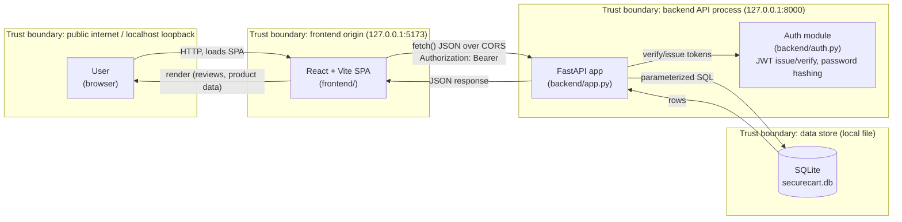

# Threat Model

## Data-flow diagram and trust boundaries

Four trust boundaries matter here:

1. **Browser ↔ Frontend origin** — the browser enforces same-origin policy and CORS;
   this boundary is where a malicious third-party page (AM-06) or an injected script
   from a stored review (AM-08) would try to act on the user's behalf.
2. **Frontend ↔ Backend API** — the SPA is just another untrusted HTTP client from the
   API's point of view; every request must be independently authenticated/authorized
   server-side (never trust client-side role checks or hidden UI).
3. **API process boundary** — code running inside `backend/app.py` is trusted, but
   every value that crosses into it from a request (query params, JSON body, JWT
   claims) is untrusted until validated.
4. **API ↔ Database** — the only trusted writer/reader of `securecart.db` is the
   backend process; the boundary is crossed only through parameterized queries, never
   by handing attacker-controlled text straight to SQLite.

## STRIDE analysis

| Component | Threat (STRIDE) | Scenario | Planted flaw | Planned mitigation |
|-----------|------------------|----------|----------------|---------------------|
| Frontend ↔ API (auth) | **S**poofing | Attacker forges a JWT using a secret found in source control. | VULN-05 (hardcoded secret) | Load `SECRET_KEY` from an environment variable; fail to start if unset (SR-03). |
| Frontend ↔ API (auth) | **S**poofing | Attacker replays a JWT stolen months ago; it still works because it never expires. | VULN-06 (no `exp`) | Add short `exp` claim, verified on every request (SR-04). |
| Backend (login) | **S**poofing / Repudiation | Attacker brute-forces/stuffs credentials with no limit on attempts. | VULN-04 (no rate limit) | Per-account/IP rate limiting + temporary lockout, logged (SR-02, SR-13). |
| Backend (users table) | **T**ampering (via disclosure) | Attacker dumps `users` via SQLi, then cracks unsalted MD5 hashes offline. | VULN-01, VULN-03 | Parameterized queries (SR-11); Argon2 salted hashing (SR-01). |
| API ↔ Database (search) | **T**ampering | Attacker injects SQL through the search query string, altering query logic (UNION, boolean-based). | VULN-01 | Parameterized queries everywhere (SR-11). |
| API (orders) | **T**ampering / Information Disclosure | Attacker reads/could tamper with another user's order by changing the ID (IDOR). | VULN-02 | Ownership check: `order.user_id == current_user.id` or admin (SR-05). |
| API (error handling) | **R**epudiation / Information Disclosure | Error responses leak stack traces and raw SQL, aiding further attacks and hiding true failure causes from operators (logs are the client's console, not the server's). | VULN-09 | Generic client-facing errors; full detail logged server-side (SR-08, SR-13). |
| API (admin routes) | **E**levation of Privilege | Any authenticated user calls `/api/admin/*` directly, since only login (not role) is checked. | VULN-08 | Explicit `require_admin` dependency on every admin route (SR-06). |
| Frontend (reviews) | **T**ampering / Elevation of Privilege (client-side) | Attacker stores an XSS payload in a review; it executes in every later visitor's browser, including an admin's, enabling session/token theft or unwanted actions. | VULN-07 | Backend validates/sanitizes review text; frontend renders as text, not HTML (SR-12). |
| Frontend ↔ API (CORS) | **I**nformation Disclosure | A malicious page on another origin calls the API from a logged-in victim's browser and reads the response because `Access-Control-Allow-Origin: *`. | VULN-10 | Restrict `allow_origins` to the real frontend origin (SR-09). |
| All HTTP responses | **T**ampering (clickjacking) / Information Disclosure | Missing security headers (no CSP/X-Frame-Options/etc.) widen the impact of any residual injection and allow framing/clickjacking. | VULN-11 | Add CSP, `X-Frame-Options: DENY`, `X-Content-Type-Options: nosniff`, `Referrer-Policy`, HSTS (SR-10). |
| Backend dependencies | **E**levation of Privilege | A known CVE in the pinned JWT library (algorithm confusion) lets an attacker forge tokens without touching app code. | VULN-12 | Upgrade/replace the vulnerable dependency; verify with `pip-audit` in CI (SR-14). |
| Backend (overall) | **D**enial of Service (not planted, noted for completeness) | No request size/length limits on inputs (e.g. review text) could allow resource exhaustion. | — (out of scope for this pass) | Future work: request size limits, timeouts. |

Every row above maps 1:1 to a `VULN-xx` entry in [`VULNERABILITIES.md`](VULNERABILITIES.md)
and a requirement in [`SECURITY_REQUIREMENTS.md`](SECURITY_REQUIREMENTS.md); the v2 fixes
in this pass implement the "planned mitigation" column.
